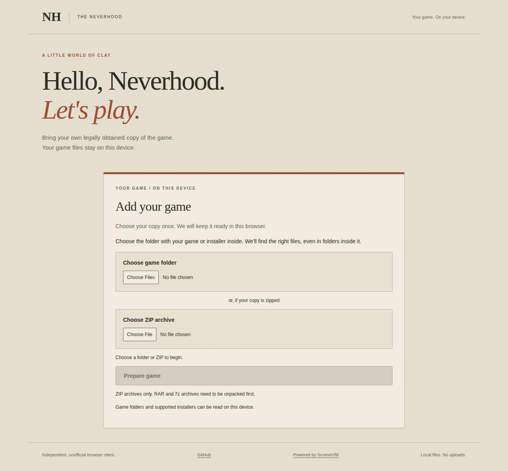

# Neverhood Online

[](https://github.com/mihmosh/neverhood_online/actions/workflows/ci.yml)

Play your own copy of The Neverhood directly in your browser.

Neverhood Online is an independent, open-source browser interface around
[ScummVM](https://www.scummvm.org/)'s existing Neverhood engine, compiled to
WebAssembly with [Emscripten](https://emscripten.org/). It is not a new game
engine, a new reverse-engineering effort, an official release or a remaster.
**You supply the game. No game archives or installers are included.**

[Play in your browser](https://nevehood-online.vercel.app) |
[Source code](https://github.com/mihmosh/neverhood_online) |
[Report a bug](https://github.com/mihmosh/neverhood_online/issues) |
[Contribute](CONTRIBUTING.md)

The live address above is intentional: its existing hostname is spelled
`nevehood-online`. The live deployment may lag this repository, including its
latest ZIP filename fixes.



## Play With Your Own Copy

1. Open the site in a current desktop Chromium browser using a normal browser profile.
2. Choose a folder or ZIP containing your legally obtained installed game, or a supported Inno Setup installer together with all its adjacent BIN parts.
3. Let the importer find the game inside nested folders and extract it automatically where needed. You do not need to pick individual BLB or installer files.
4. Wait for the local import to finish, then choose **Play**. Use the in-game menu with Escape, or **Return to site** to leave the player.

Import and extraction happen locally in the browser. The Windows installer is
parsed by [innoextract](https://constexpr.org/innoextract/) in a WebAssembly
worker, not executed. ZIP decompression uses [fflate](https://github.com/101arrowz/fflate).
Game files are stored in the site's Origin Private File System (OPFS), not uploaded
to a server, and the stored library is discovered again after reload.

The importer looks for `a.blb`, `c.blb`, `hd.blb`, `i.blb`, `m.blb`, `s.blb`
and `t.blb`. A supported installer folder can be inside a ZIP. Inno Setup 5.4.2
was tested; support for every installer, repack or game edition is not promised.
ZIP supports stored and deflated entries. RAR, 7z, encrypted ZIP and ZIP64 are
unsupported: unpack those containers locally, then choose the resulting folder.

### Storage And Compatibility

- Desktop Chromium is the current verified target. Firefox, Safari and mobile gameplay are not verified.
- Use sufficient free disk space and RAM. Temporary extraction can need additional space alongside the final library; private browsing may impose stricter limits.
- Launch currently copies the game resources from OPFS into the runtime's RAM filesystem. This is not streaming playback or a low-memory mobile implementation.
- Browser storage belongs to the exact site origin. Changing hostname or port creates separate storage; clearing site data or browser eviction can remove your library and saves. Keep your original files.
- Removing the imported library does not delete your source files or intentionally remove the separate save directory. Browser storage is not a backup.

## Project Status

This is an early, working desktop-oriented project, not a promise of complete
game compatibility. Real Chromium checks have covered folder and installer ZIP
import, reload persistence, the first room and Escape menu, focused high-DPI
4:3 rendering, resizing, in-game Quit, Return to site and replay without reloading.

**Important limitations:**

- A full playthrough and audible sound have not been verified.
- The IDBFS save directory passed a persistence probe, but real in-game save/load across sessions is not fully verified. Save backup export/import is not available. Do not rely on this browser build for irreplaceable progress.
- Offline relaunch is not ready. Local game storage alone does not make the site available offline.
- HD resource replacements are not implemented. Filtered high-DPI display scales the original artwork; it does not create an HD remaster.

The automated suite has passed 47 tests; this is not a substitute for gameplay
testing. See [testing](docs/TESTING.md) and the [verification log](docs/PLAN.md)
for scope and outstanding work.

## Local Development

Use **Node.js 22 or later**. The client, local server and automated tests require
no npm dependencies and no `npm install`. A fresh clone includes the reviewed
WASM artifacts and matching source downloads; normal development does not need
Emscripten, a C++ compiler or game files.

```sh
git clone https://github.com/mihmosh/neverhood_online.git
cd neverhood_online
npm test
npm run build
npm run dev
```

Open `http://127.0.0.1:4173`. To check the packaged static site instead, stop the
development server and run:

```sh
PORT=4174 npm run preview
```

Open `http://127.0.0.1:4174`. This origin has its own browser storage.
Browser integration tests require separately installed Playwright/Chrome and,
for game checks, your own local game files. See [development testing](docs/TESTING.md).

### Rebuilds And Hosting

Only engine/extractor maintainers need to rebuild WASM. The pinned runtime source
revision is `c546a4c80d2daf3bb1d5a3652279e26f762c0204`, built with Emscripten
4.0.10. Follow the [source restoration and rebuild instructions](web/public/sources/README.txt)
and [maintenance commands](docs/TESTING.md). When changing compiled artifacts,
regenerate their corresponding sources and manifest with `npm run package:sources`.
Preserve notices and ship matching sources alongside binaries.

`npm run build` creates an allowlisted `dist/` for static HTTPS hosting; it does
not compile C++ or copy private game data. The local Node server is not a Vercel
function. See [deployment requirements](docs/DEPLOYMENT.md) for headers, source
delivery and `npm run verify:deployment -- <origin>` checks. The existing live
deployment and this public repository may be updated at different times.

## How It Works

The static client discovers the selected game files, validates the set and stages
imports transactionally in OPFS. Dedicated workers handle ZIP and Inno Setup
extraction. On Play, a disposable iframe starts the Neverhood-only ScummVM runtime,
copies the resources into MEMFS and mounts IDBFS for saves. Leaving the player
flushes the save filesystem and disposes that runtime session. Game logic remains
in ScummVM's C++ engine. See [architecture](docs/ARCHITECTURE.md).

| Path | Purpose |
| --- | --- |
| `web/` | Browser interface, import workers, storage and player adapter |
| `web/public/runtime/` | Generated ScummVM WASM, engine helper data and upstream notices |
| `web/public/extractor/` | Generated innoextract WASM and dependency notices |
| `web/public/sources/` | Matching source archives, checksums and rebuild instructions |
| `web/vendor/` | Pinned fflate decoder, license and provenance |
| `scripts/`, `tools/` | Build, packaging and verification tools |
| `test/`, `web/test/` | Automated and browser checks |
| `server.mjs` | Restricted local development/preview server |
| `docs/` | Architecture, testing, deployment and verification history |

An optional local `scummvm/` checkout is upstream source, not required for a normal
site build. Private game directories and toolchain build caches are not publication
inputs.

## Credits And License

This project depends on the work of the **ScummVM contributors**, **Emscripten
contributors**, **Daniel Scharrer and innoextract contributors**, **Arjun Barrett
(fflate)**, and the authors of SDL and the other bundled libraries. Their code,
attribution and license terms remain their own. See [third-party notices](THIRD_PARTY_NOTICES.md)
for exact versions and license locations.

Neverhood Online is distributed under the **GNU General Public License, version
3 or (at your option) any later version**, SPDX `GPL-3.0-or-later`; see [LICENSE](LICENSE).
This is also the license election in `package.json`. Individual files with an
explicit MIT SPDX notice and third-party components retain their own licenses;
the root license does not relicense them. Matching binary sources are available
through the site's [source downloads](https://nevehood-online.vercel.app/sources/index.html)
and in `web/public/sources/`.

The Neverhood's name, characters, artwork, music and commercial game data remain
the property of their respective rights holders. Software licensing does not
grant rights to those assets, authorize redistribution of your game copy, or
provide legal immunity. Use only files you are entitled to use and follow
applicable law. No gameplay images, original game archives or installers are
provided by this project.

This is an independent project with AI-assisted first-party development, not an
endorsement by ScummVM, the original game's creators or any rights holder.
Contributions and reports are welcome under [CONTRIBUTING.md](CONTRIBUTING.md);
for sensitive reports, read [SECURITY.md](SECURITY.md).
